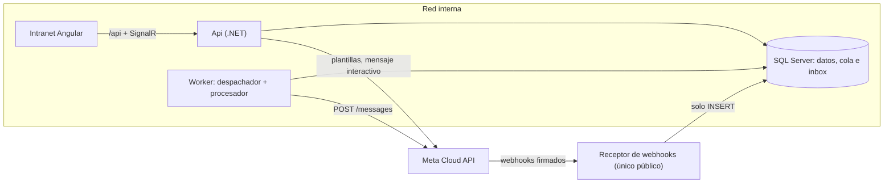
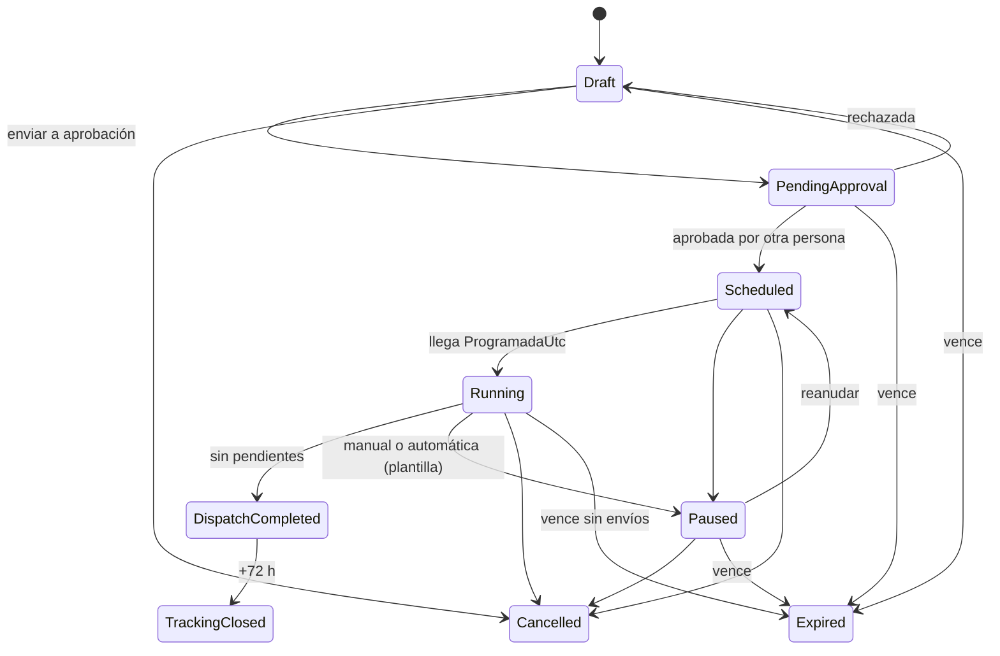
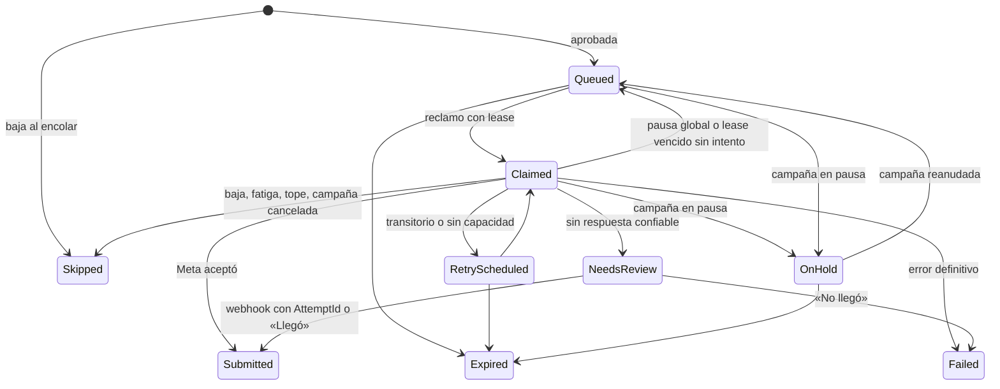
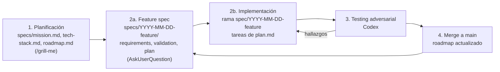

# Traspaso: WhatsApp Bulk (PoC) → solución in-house

Insumo para la fase de **Planificación** del proyecto nuevo (SDD). Reúne lo que se construyó, se probó y se decidió en el PoC, lo que cambia ahora y lo que se recomienda, desde la arquitectura, antes de escribir `specs/mission.md`, `specs/tech-stack.md` y `specs/roadmap.md`.

- **Origen:** repositorio privado `Avillegasa/whatsapp-bulk`, rama `dev`, commit `02789e3` (2026-11-18). Queda congelado como referencia (D-040).
- **Fecha de este documento:** 2026-11-19.
- **Documento de diseño original (Claude Docs):** https://claude.ai/artifact/4QbfsuRFZo1uKJcBwJaLgu — verificado contra la documentación de Meta al 2026-11-16.
- **Fuentes de este traspaso:** `CLAUDE.md`, `docs/ARQUITECTURA.md`, `docs/PLAN.md`, `docs/PROGRESO.md`, `docs/DECISIONES.md` (D-001…D-039), `docs/META-SETUP.md`, el documento de diseño y el código.

---

## 0. Cómo usar este documento

No es una spec: es evidencia y recomendaciones. Todo lo que dice se **confirma o se cambia** durante `/grill-me` y queda escrito en `specs/`.

| Sección | Alimenta |
| --- | --- |
| 1–3 Resumen, estado y qué cambia | Contexto de `specs/mission.md` |
| 4 Insumos de misión | `specs/mission.md` |
| 5 Stack y arquitectura · 8 Meta | `specs/tech-stack.md` |
| 6 Modelo de datos · 7 Reglas | `specs/tech-stack.md` o, si se separan, `specs/data-model.md` y `specs/rules.md` |
| 9 Alcance ampliado | `specs/mission.md` (alcance) y `specs/roadmap.md` (fases nuevas) |
| 10 Interfaz | Claude Design → `specs/ui-design.md` |
| 11–12 Recomendaciones y riesgos | Todas las specs |
| 13 Banco de preguntas | Sesiones de `/grill-me` |
| 14 Roadmap sugerido | `specs/roadmap.md` |
| 15 Flujo SDD y skills | `CLAUDE.md` del repo nuevo |
| 16–19 Anexos | Consulta |

Etiquetas usadas:

- **[MANTENER]** probado en el PoC; se recomienda tal cual.
- **[REVISAR]** decisión que cambia con el nuevo contexto.
- **[ABIERTO]** nunca se decidió.
- **[VERIFICAR]** dato de Meta, Microsoft o Angular que hay que confirmar en la documentación oficial antes de usarlo (regla 1 del PoC).

---

## 1. Resumen en una pantalla

- El PoC probó, con el número de prueba de Meta y hasta 5 destinatarios, la cadena completa: plantilla → campaña aprobada por otra persona → cola con lease → envío sin duplicados → webhooks firmados → estados, bajas, capacidad y freno de emergencia, con una intranet Angular por roles y un monitor en vivo.
- La Fase 0 (12 tareas) quedó verificada. La Fase 1 (demo) quedó cerca del 80 %: lo que falta depende de que Meta apruebe las plantillas, del despliegue en Docker y de la demo.
- La gerencia acordó desarrollar la solución **in-house como proyecto nuevo**, con **activos reales de Meta desde el inicio** y **un alcance más amplio** que las promociones.
- Lo más valioso que se lleva: las reglas anti-duplicados y de consentimiento, el modelo de datos, la tabla de errores de Meta, las lecciones sobre webhooks y el banco de pruebas (Meta falso, replay firmado, integración contra SQL Server real, E2E).
- Las cinco decisiones que más condicionan el proyecto nuevo (detalle en la sección 13):
  1. Dónde atienden los chats los encargados si el número pasa a la API (bandeja propia, coexistencia o dos números).
  2. Cómo llegan los eventos del ERP para los avisos de utility (pedido, factura).
  3. Autenticación: Identity propio (como el PoC) o la corporativa/Entra ID desde el día 1.
  4. Dónde corren SQL Server y el receptor público en producción (D-006, nunca resuelta).
  5. Entornos de Meta: app y número de prueba para desarrollo, app y número real solo para producción.

---

## 2. Estado del PoC al pausar

### 2.1 Tareas

| ID | Tarea | Estado | Nota |
| --- | --- | --- | --- |
| F0.1–F0.12 | App de Meta, repo, esqueleto .NET, SQL Server, cliente Meta, receptor, procesador, replay, cola con lease, bajas, capacidad, alertas | Verificado | Puerta de la Fase 0 cumplida (commit `1bbebf2`) |
| F1.1 | Preparar la demo | En curso | Entrantes reales OK; `promo_demo` en revisión de Meta; 3 de 5 destinatarios |
| F1.2 | Login y esqueleto Angular | Verificado | Identity + cookie + XSRF + roles |
| F1.3 | Usuarios, autorización y auditoría | Verificado | Políticas con nombre, `AuditLog` en la misma transacción |
| F1.4 | Contactos y consentimiento por WhatsApp | Verificado | Opt-in real por botones |
| F1.5 | Plantillas | En curso | Código listo; falta `APPROVED` real de Meta |
| F1.6 | Campañas versionadas y aprobación | Hecho (sin verificar) | Espera F1.5 |
| F1.7 | Despacho completo | En curso | Controles hechos; falta aviso por correo y prueba real |
| F1.8 | Monitor en vivo y tablero | Hecho (sin verificar) | Probado en el navegador |
| F1.8b | Diseño visual de la intranet | Verificado | Tema claro/oscuro, móvil, E2E 34/34 |
| F1.9 | Docker y despliegue | Pendiente | Bloqueada por D-006 |
| F1.10 | Demo en la oficina | Pendiente | — |

Cifras al pausar: 77 commits; 319 pruebas de backend (xUnit, unitarias e integración contra SQL Server en base temporal); 32 de frontend (Vitest); E2E 34/34; 39 decisiones registradas.

### 2.2 Qué se comprobó en real, qué solo con simulación y qué nunca

| Comprobado con Meta real | Solo con replay o Meta falso | Nunca probado |
| --- | --- | --- |
| Envío de plantilla y `wamid` guardado | `user_preferences` stop/resume | Webhook `APPROVED` real de una plantilla propia |
| Estados `sent`/`delivered`/`read` reales, llegados en desorden | Plantilla `PAUSED`, calidad y recategorización | Campaña real con plantilla aprobada |
| Mensajes entrantes con la app sin publicar (número de prueba) | Errores 190, 131042, 132015, 131048, 131031, 368 | Payload real del botón «No recibir más» |
| Baja por palabra clave «BAJA» | `business_capability_update` | Despliegue en Docker y receptor público con HTTPS |
| Opt-in por mensaje interactivo de botones | Tasa de fallos > 5 % | Conciliación de `pricing` contra la facturación |
| Creación de plantilla desde la intranet (`PENDING`) | Dos despachadores concurrentes | Capacidad con un tier real y carga real |
| Monitor por SignalR (banner EN PAUSA en ~2 s) | — | Varias instancias del Worker en producción |

---

## 3. Qué cambia en el proyecto nuevo

| Aspecto | PoC | Proyecto nuevo | Consecuencia |
| --- | --- | --- | --- |
| Activos de Meta | Portafolio de prueba, número de prueba, 5 destinatarios, app sin publicar, gratis | Portafolio de la empresa verificado, número dedicado, método de pago | Costos reales; la calidad del número está en juego; límite por tier; hace falta un entorno de pruebas separado (sección 8.6) |
| Alcance | Solo promociones (marketing) | Promociones + otros usos a precisar: avisos de utility, atención de chats, integración con ERP/CRM | Consentimiento por finalidad, capacidad compartida, mensajería genérica (sección 9) |
| Stack | Angular 21, .NET 10, SQL Server 2022 | Se asume el mismo; confirmar versiones | Angular 21 tiene LTS hasta junio de 2027 [VERIFICAR] |
| Método | `PLAN.md` / `PROGRESO.md` + skills `wa-sesion` y `wa-verificar` | SDD: `specs/` + feature specs + pruebas adversariales con Codex | Ver sección 15 |
| Equipo | Andrés + Claude Code + Claude desktop | Andrés + Claude Code + Codex | `AskUserQuestion` en planificación e implementación |

---

## 4. Insumos para `specs/mission.md`

### 4.1 Problema

- Hoy se envían promociones por WhatsApp a mano a 150–200 personas cada 2–4 semanas (D-011).
- La base es de unos 3.000 clientes; no está acreditado cómo dieron su consentimiento.
- No hay control de bajas, de frecuencia, de duplicados ni métricas; un número bloqueado por reportes corta el canal con los clientes.

### 4.2 Objetivo

Un canal oficial (WhatsApp Cloud API de Meta, sin BSP ni WhatsApp Web) para enviar mensajes a clientes **con consentimiento**, sin duplicados, respetando las bajas, con aprobación y trazabilidad, y sin poner en riesgo la calidad del número.

### 4.3 Usuarios y roles

| Rol | Hace | Origen |
| --- | --- | --- |
| Operador | Contactos, importación, listas, plantillas, campañas, monitor, envíos inciertos, bajas, oferta de promociones | PoC |
| Aprobador | Aprueba o rechaza campañas (nunca las suyas), atiende alertas y reanuda el despacho | PoC |
| Admin | Usuarios y roles | PoC |
| Agente de atención | Responde chats dentro de la ventana de 24 h | Nuevo, si entra la bandeja [ABIERTO] |
| Sistema ERP | Origina avisos de pedido o factura | Nuevo, si entran los avisos [ABIERTO] |
| Cliente final | Recibe, responde, toca botones, se da de baja | — |

Un usuario puede tener varios roles; Admin no implica los demás (D-030).

### 4.4 Alcance por etapa (propuesta)

| Etapa | Contenido | Estado |
| --- | --- | --- |
| 1 | Promociones (plantillas MARKETING): todo lo del PoC llevado a producción | Recomendado como primera etapa: el diseño está probado |
| 2 | Avisos de utility (pedido, factura emitida) originados en el ERP, con consentimiento propio | [ABIERTO] confirmar tipos de aviso y sistema origen |
| 3 | Atención de chats en la intranet (bandeja compartida) | [ABIERTO] depende de la decisión de números (sección 9.2) |
| Nunca | Cobranza, recordatorios de pago o saldos vencidos ("debt collection" está prohibido por la política de WhatsApp Business) | [MANTENER] |

### 4.5 Métricas y puertas de éxito (del PoC y del diseño)

- Cero duplicados: ninguna consulta encuentra dos intentos `Accepted` para el mismo (versión de campaña, contacto).
- Bajas aplicadas en menos de 1 minuto entre el webhook y el trabajo `Skipped`.
- Calidad del número en `GREEN`; reintentos solo en códigos transitorios.
- Producción estable: un mes sin pausas automáticas por calidad y tasa de bajas por campaña menor al 1 % (sugerencia inicial a validar con el negocio).
- Costo por campaña conciliado con la facturación de Meta.

### 4.6 Principios (candidatos a "constitución" del proyecto)

1. Solo el canal oficial de Meta.
2. Sin consentimiento vigente para la finalidad, no sale nada.
3. Nunca dos mensajes de la misma campaña a la misma persona; lo incierto nunca se reenvía solo.
4. La calidad del número es el activo principal: frecuencia baja, rampa gradual, freno de emergencia.
5. Todo cambio de negocio queda auditado en la misma transacción.
6. Lo externo (versión de Graph API, límites, textos, horarios) es configuración, no código.
7. Ninguna decisión sobre Meta, Microsoft o Angular se toma sin la documentación oficial a la vista.

### 4.7 No-objetivos

- WhatsApp Web, extensiones de navegador o librerías que emulan el cliente (bloqueo del número, sin estados confiables).
- Un BSP, salvo que la atención de chats exija coexistencia y no haya otra vía (sección 9.2).
- Mensajes a contactos sin consentimiento acreditado.

---

## 5. Insumos para `specs/tech-stack.md`

### 5.1 Stack del PoC

| Capa | PoC | Estado | Nota |
| --- | --- | --- | --- |
| Frontend | Angular 21.2, standalone, signals, zoneless, Vitest | [REVISAR] | D-002: Angular 21 en LTS hasta junio de 2027 y 22 como versión activa [VERIFICAR]; decidir si se arranca en 22 |
| Backend | .NET 10 (SDK 10.0.404), ASP.NET Core Minimal APIs, Worker Service | [MANTENER] | LTS hasta noviembre de 2028 (D-003) |
| Datos | SQL Server 2022 (Docker en desarrollo), EF Core 10.0.15; SQL crudo para la cola | [MANTENER] | D-004, D-013, D-017 |
| Tiempo real | SignalR, cliente `@microsoft/signalr` 10.0.11 | [MANTENER] | D-036 |
| Autenticación | ASP.NET Core Identity con cookie, roles y políticas con nombre | [REVISAR] | ¿Corporativa o Entra ID desde el inicio? (D-005) |
| Importación | CSV y Excel con ClosedXML 0.105.0 | [MANTENER] | — |
| Despliegue | Contenedores Docker: Api, Webhooks, Worker y frontend con nginx | [ABIERTO] | D-006: dónde corre SQL Server y cómo se publica el receptor |
| Túnel de desarrollo | Microsoft Dev Tunnels, nombre `avit-<proyecto>` | [MANTENER] | D-014, D-039 (pedido de Infraestructura) |
| Pruebas | xUnit + `WebApplicationFactory` + SQL Server real; Vitest; E2E en Node con Edge por DevTools | [MANTENER] | Ver 5.6 |
| Repositorio | GitHub privado | [MANTENER] | Nuevo repo |
| Graph API | v27.0, configurable (`Meta:GraphApiVersion`) | [MANTENER] | Nunca literal en el código |

### 5.2 Arquitectura

| Componente | Responsabilidad |
| --- | --- |
| Intranet (Angular) | Contactos, plantillas, campañas, aprobación, monitor, bajas, alertas, usuarios. Nunca habla con Meta |
| Api | Reglas de negocio, usuarios y roles, sincronización de plantillas, materialización de la cola (al aprobar), monitor por SignalR |
| Receptor de webhooks | Handshake GET, firma, guardar en `WebhookInbox`, responder 200. Nada de lógica de negocio |
| Worker | Despachador (envía desde la cola) y procesador del inbox (aplica eventos), en dos `BackgroundService` |
| Dominio | Entidades, estados, reglas puras (elegibilidad, reintentos, fatiga, presupuesto) sin dependencias |
| Infraestructura | EF Core, SQL crudo de la cola, clientes de Meta, servicios |
| SQL Server | Fuente de verdad, cola (`DispatchJob`) e inbox |

La Api nunca envía en masa de forma síncrona: todo envío masivo pasa por la cola.

### 5.3 Patrones que sostienen el diseño [MANTENER]

| Patrón | Cómo | Por qué |
| --- | --- | --- |
| Intento antes del POST | Se inserta y confirma `SendAttempt` (`Submitting`, AttemptId = Guid v7) y recién se llama a Meta; `biz_opaque_callback_data` = AttemptId | Cloud API no documenta una clave de idempotencia; si el proceso cae, se sabe que hubo un intento (D-010) |
| Sin reintento genérico | Ni Polly ni `AddStandardResilienceHandler` sobre `/messages`; el despachador decide por código de error | Un reintento automático tras un timeout puede duplicar |
| `SubmissionUnknown` | Timeout, conexión cortada, 5xx sin cuerpo o caída en `Submitting` → `NeedsReview`, nunca reenvío | Solo un webhook con ese AttemptId o una persona lo resuelven |
| Inbox de webhooks | Validar firma sobre bytes crudos → guardar → 200; procesar aparte, idempotente | Meta reintenta hasta 7 días, duplica y desordena |
| Cola en SQL con lease | `UPDATE … WITH (UPDLOCK, READPAST, ROWLOCK)` sobre un índice filtrado en el mismo orden del `ORDER BY`; `LockedBy` + `LeaseUntilUtc`; toda escritura verifica que sigue siendo dueño | Varios despachadores sin broker; sin bloqueos durante el HTTP (D-024) |
| Reserva de capacidad | `sp_getapplock` exclusivo por portafolio mientras cuenta e inserta | Dos despachadores no superan el presupuesto (D-026) |
| Versión inmutable | `CampaignVersion` con audiencia congelada y `Hash` SHA-256; el aprobador manda Id + Hash | Se aprueba exactamente a quién y qué se envía (D-034) |
| Aprobación atómica | UPDATE condicional + versión aprobada + un `DispatchJob` por contacto + AuditLog en una transacción; índice único como segunda barrera | Dos aprobaciones simultáneas crean trabajos una sola vez |
| Estados separados | Despacho (`DispatchJob`) y entrega (`SendAttempt.EstadoEntrega`); la entrega solo avanza | Los webhooks llegan en desorden |
| Políticas con nombre | `PuedeEnviar`/`PuedeAprobar`/`PuedeAdministrar`; una prueba falla si un endpoint no tiene política | Sumar Entra ID sin rehacer la autorización (D-030) |
| Auditoría transaccional | Cambio + `AuditLog` en la misma transacción | Si falla la auditoría, el cambio se revierte |
| Configuración validada al arrancar | `ValidateOnStart` (ej.: lease ≥ 2 × timeout de Meta) | Un error de configuración no llega a producción |
| Meta falso por configuración | `Meta:BaseUrl` apunta a un servidor falso en pruebas y E2E | Se prueba el mismo código que en producción |

### 5.4 Parámetros de configuración (valores del PoC)

| Sección | Parámetro | Valor | Nota |
| --- | --- | --- | --- |
| `Meta` | `GraphApiVersion` | v27.0 | Nunca literal |
| `Meta` | `RequestTimeoutSeconds` | 30 | — |
| `Dispatcher` | `Enabled` | false | Apagado por defecto en desarrollo (D-024) |
| `Dispatcher` | `BatchSize` / `PollSeconds` / `LeaseSeconds` | 10 / 2 / 120 | Lease ≥ 2 × timeout |
| `Dispatcher` | `MaxAttempts` / `RetryBaseSeconds` / `RetryMaxSeconds` | 5 / 30 / 1800 | Backoff ×2 con jitter |
| `Dispatcher` | `NoCapacityRetryMinutes` | 5 | Sin lugar → `RetryScheduled` sin sumar intento |
| `Dispatcher` | `MessagesPerSecond` / `RateBurst` | 10 / 1 | Techo de Meta: 80/s por número |
| `Dispatcher` | `AllowedFrom` / `AllowedUntil` / `TimeZone` | 08:00 / 20:00 / America/La_Paz | — |
| `Dispatcher` | `NeedsReviewHours` | 2 | Inciertos vencidos para revisión |
| `InboxProcessor` | `BatchSize` / `PollSeconds` / `MaxAttempts` | 50 / 2 / 8 | Espera 30 s ×2, tope 10 min |
| `Capacity` | `PortfolioLimit` / `UsagePercent` / `ManualQuota` | 250 / 90 / 200 | Se reemplaza por el límite real leído de Meta (`MessagingLimit`) |
| `Capacity` | `RefreshHours` | 6 | Lectura del límite real |
| `OfertaPromociones` | `MaxPromotionsPerWeek` | 2 | Igual en Api y Worker (una prueba lo exige) |
| `OfertaPromociones` | `ReofferAfterDays` / `WindowMarginMinutes` | 30 / 10 | — |
| `Campanias` | `TrackingHours` | 72 | Cierre del seguimiento |
| `Bajas` | `Keywords` | BAJA, STOP, SALIR, DETENER, CANCELAR | Mensaje completo normalizado, no "contiene" |
| `Bajas` | `ButtonTexts` / `ButtonPayloads` | «No recibir más» / `BAJA_PROMOCIONES` | Confirmar con un toque real |
| `Plantillas` | `InterestButton` | «Me interesa» | Señal de interés para la fatiga |
| `Monitor` | `PushSeconds` | 2 | Meta de < 5 s en pantalla |

### 5.5 Seguridad

- Secretos: token del System User, App Secret, verify token y PIN. En desarrollo, `dotnet user-secrets` (un solo almacén para todos los proyectos, D-018); en Docker, variables de entorno o `.env` ignorado; en producción, Key Vault o variables protegidas [ABIERTO con Infraestructura]. Nunca en la base ni en el repositorio.
- Incidentes del PoC: el token y el App Secret se pegaron en el chat tres veces y hubo que rotarlos. Regla: pegar solo la salida, nunca la línea del comando con el secreto; usar el truco `for /f` de cmd para cargar el token en una variable sin mostrarlo.
- Webhooks: `X-Hub-Signature-256` con HMAC-SHA256 sobre los bytes crudos y `FixedTimeEquals`; 401 sin firma válida; 413 sobre 5 MB; 503 si faltan los secretos (para que Meta reintente).
- Intranet: cookie HttpOnly, SameSite=Strict, 8 h deslizante, `Secure` fuera de desarrollo; 401/403 sin redirección; XSRF con cookie `XSRF-TOKEN` + encabezado `X-XSRF-TOKEN` en todo POST/PUT/PATCH/DELETE; bloqueo tras 5 claves malas (15 min); clave mínima de 10 caracteres; la sesión se revalida en cada petición (desactivar surte efecto al instante).
- Producción: nginx sirve la app y `/api` bajo el mismo dominio (Angular solo envía el XSRF a URLs relativas).
- Recomendado y no implementado: usuario de base de datos del receptor con permiso solo de INSERT en `WebhookInbox`; dos administradores del portafolio con verificación en dos pasos; System User dedicado solo a esta app y esta WABA.

### 5.6 Estrategia de pruebas que funcionó

- **Dominio:** reglas puras con pruebas unitarias (reintentos, elegibilidad, fatiga, presupuesto, plantillas).
- **Integración con SQL Server real:** base temporal `<Proyecto>_Test_<guid>` por clase, marcada `Category=Integration`. InMemory no sirve: no tiene `UPDLOCK`/`READPAST` ni transacciones. Así se encontró que sin índice en el orden del `ORDER BY` un reclamo bloqueaba todos los candidatos.
- **HTTP falso de Meta:** handler falso para 200, errores con código, timeout y conexión cortada; se cuenta cuántos POST hubo.
- **Pruebas de mutación manuales:** quitar `sp_getapplock` o la regla de cuatro ojos y comprobar que las pruebas fallan.
- **Replay firmado** (`tools/webhook-replay`): firma payloads con el App Secret y los manda al receptor local; escenarios de duplicado, desorden, lote, stop/resume, plantilla PAUSED/APPROVED/REJECTED, calidad, categoría, bajas.
- **E2E de la intranet** (`tools/e2e-frontend`): app real con base temporal y Meta falso, Api/Webhooks/Worker compilados aparte; encontró dos defectos que las unitarias no veían.
- **Scripts de verificación SQL** por tarea (`db/scripts/verificar-*.sql`) para dejar evidencia legible.
- **Hueco:** no hubo CI. En el proyecto nuevo, GitHub Actions desde el día 1 (sección 11).

### 5.7 Observabilidad (hueco del PoC)

Solo hubo logs y tablas (`Alert`, `DispatchPause`). Falta: aviso fuera del log (se decidió **correo**, después de la demo; hace falta servidor SMTP, cuenta remitente y destinatarios), métricas (antigüedad de la cola, inbox pendiente, minutos desde el último webhook, tasa de fallos) y trazas. Recomendado: OpenTelemetry hacia lo que Infraestructura ya use [ABIERTO].

---

## 6. Modelo de datos (base)

Convención del PoC: propiedades en inglés y columnas en español (`HasColumnName`), enums guardados como texto, índices únicos sobre columnas que admiten NULL siempre filtrados (`WHERE col IS NOT NULL`). Decidir si se mantiene (sección 13).

### 6.1 Tablas

| Dominio | Tabla | Campos clave | Notas |
| --- | --- | --- | --- |
| Contactos | `Contact` | Id, PhoneE164 (único filtrado), WaId, UserId/BSUID (único filtrado), Nombre, ClienteId, Activo | E.164 Bolivia: 591 + 8 dígitos; mapeo BSUID ↔ teléfono (D-032) |
| Contactos | `InboundMessage` | Wamid (único), ContactId, PhoneE164, UserId, Tipo, Texto, BotonId, WamidContexto, FechaUtc | Abre la ventana de 24 h |
| Contactos | `Segment`, `SegmentMember` | Nombre único; SegmentId, ContactId | Listas estáticas; se congelan al crear la versión |
| Consentimiento | `ConsentOffer` | ContactId, VersionTexto, Texto, OfrecidoPor, Estado (Enviando/Enviada/Rechazada/Incierta), Wamid, Respuesta (Si/AhoraNo) | Se guarda y audita antes del único POST |
| Consentimiento | `ConsentRecord` | ContactId, PhoneE164, Finalidad, Canal, Estado (OptIn/OptOut/NoContactar), Fuente, Evidencia, WamidOrigen (único filtrado), FechaUtc, RegistradoPor | Historial inmutable; vigente = último por teléfono y finalidad |
| Consentimiento | `PlatformPreference` | PhoneE164, Categoria, Valor (stop/resume), Origen (Webhook/Error131050), FechaUtc | Capa separada; vigente = hora de Meta más reciente |
| Plantillas | `Template` | MetaTemplateId, Nombre, Idioma, Categoria, Estado, Calidad, Componentes (JSON), EstadoUtc | Estados de Meta como texto + propios CREANDO/INCIERTA/ERROR_CREACION/NO_ENCONTRADA |
| Campañas | `Campaign` | Nombre, Estado, VersionActualId, MotivoEstado, EstadoUtc, DespachoCompletoUtc, CreadaPor | — |
| Campañas | `CampaignVersion` | Numero, TemplateId, Idioma, Categoria, Audiencia (Ids), Parametros, ProgramadaUtc, ExpiraUtc, Hash, AprobadaPor/Utc, RechazadaPor/Utc | Inmutable |
| Mensajería | `DispatchJob` | CampaignVersionId, ContactId, PhoneE164, Parametros, Prioridad, ProgramadoUtc, ExpiraUtc, EstadoDespacho, Intentos, ProximoIntentoUtc, LockedBy, LeaseUntilUtc, MotivoOmision | Único filtrado (CampaignVersionId, ContactId) |
| Mensajería | `SendAttempt` | AttemptId, DispatchJobId, InicioUtc, FinUtc, Estado, Wamid (único filtrado), HttpStatus, CodigoError, Detalle, EstadoEntrega | `EstadoEntrega` solo lo escribe el procesador |
| Mensajería | `MessageEvent` | Wamid, AttemptId, Estado, TimestampMeta, Pricing, Errores | Único (Wamid, Estado) |
| Mensajería | `WebhookInbox` | RecibidoUtc, Cuerpo, Estado (Pendiente/Procesado/EnEspera/Revision), Intentos, ProximoIntentoUtc, Error | Solo el receptor inserta |
| Capacidad | `MessagingLimit` | PortafolioId, Limite, ValorMeta (TIER_*), Origen, ActualizadoUtc | Límite real de Meta |
| Capacidad | `CapacityReservation` | PortafolioId, PhoneE164, DispatchJobId, ReservadaUtc, ExpiraUtc, Estado | Destinatarios únicos en 24 h móviles |
| Alertas | `Alert` | Tipo, Clave, Mensaje, Origen, Ocurrencias, ResueltaUtc, ResueltaPor | Una abierta por (Tipo, Clave) |
| Alertas | `DispatchPause` | Alcance, Motivo, AlertId, DesdeUtc, LevantadaUtc, LevantadaPor | Una activa; el despachador no reclama |
| Seguridad | `AspNet*`, `AuditLog` | Usuario, Accion, Entidad, EntidadId, Antes, Despues, FechaUtc | Identity en la misma base |

Motivos de omisión (`DispatchJob.MotivoOmision`): SinConsentimiento, BajaEmpresa, NoContactar, BajaPlataforma, SinCampania, CampanaCancelada, VersionReemplazada, ContactoInactivo, YaEnviado, LimiteFrecuencia, Fatiga, FatigaExcluido.

### 6.2 Estados

- Entrega (por `wamid`): `Accepted` → `Sent` → `Delivered` → `Read`, o `Failed`. Solo avanza; `delivered` puede faltar si se lee de inmediato.
- Intento (`SendAttempt`): `Submitting` → `Accepted` | `Rejected` | `SubmissionUnknown`.
- Lease vencido: sin intento o con rechazo transitorio → vuelve a la cola; intento en `Submitting` → `SubmissionUnknown`/`NeedsReview`.

### 6.3 Lo que el modelo necesita para el alcance ampliado (propuesta)

| Necesidad | Propuesta | Motivo |
| --- | --- | --- |
| Envíos que no son de campaña (aviso ERP, respuesta de un agente, oferta de opt-in, prueba) | Un `OutboundMessage` genérico (origen, tipo: plantilla/texto/interactivo/media, contacto, contenido) con el mismo patrón intento-antes-del-POST | El PoC tiene dos caminos (cola de campañas y oferta directa) y un `CampaignVersionId` NULL para `send-test` |
| Avisos del ERP | `BusinessEvent` (sistema origen, tipo, clave externa única, payload, estado) | Clave de idempotencia por evento de negocio: el mismo pedido no se avisa dos veces |
| Atención de chats | `Conversation` (contacto, estado, asignado a, ventana abierta hasta), mensajes entrantes y salientes en una sola línea de tiempo | Hoy `InboundMessage` solo sirve para la ventana y el opt-in |
| Consentimiento por finalidad | `ConsentRecord.Finalidad` ya existe; elegibilidad por finalidad (hoy solo `MarketingEligibility`) | Una baja de promociones no debe frenar un aviso de factura con consentimiento propio |
| Contactos del ERP/CRM | `Contact.ClienteId` ya existe; sincronización y segmentos dinámicos (filtros) además de listas estáticas | Evitar importaciones manuales |
| Media | Archivos (factura PDF, imagen de promoción) subidos a Meta o enlazados [VERIFICAR límites y caducidad de URLs] | Plantillas con encabezado de documento o imagen |

---

## 7. Reglas de negocio e invariantes

### 7.1 Reglas que no se rompen (del PoC, adaptadas)

1. Verificar antes de asumir: endpoints, payloads, códigos y sintaxis de Meta, Microsoft o Angular se confirman en la documentación oficial; la URL queda anotada.
2. Versión de Graph API configurable, nunca literal.
3. Anti-duplicados: intento confirmado antes del POST, `biz_opaque_callback_data` = AttemptId, sin política de reintento genérica sobre `/messages`.
4. Sin respuesta confiable → `SubmissionUnknown`, nunca reenvío automático.
5. Cola: reclamo en transacción corta con lease; nunca bloqueos durante una llamada HTTP; cada actualización verifica que sigue siendo dueño.
6. Webhooks: firma sobre bytes crudos en tiempo constante; guardar y recién responder 200; procesar fuera de la petición; idempotente.
7. Despacho y entrega son estados separados; la entrega solo avanza.
8. Bajas: consentimiento de la empresa y preferencias de plataforma son capas separadas; se revisan al encolar y al enviar; un `resume` de plataforma nunca borra una baja de la empresa.
9. Reintentos solo para transitorios (4, 80007, 130429, 131056, 131000, 131016), con backoff y jitter, máximo 5, nunca después de `ExpiraUtc`.
10. Secretos nunca en el repositorio.
11. Índices únicos sobre columnas que admiten NULL, siempre filtrados.
12. Cobranza o saldos vencidos: nunca.
13. Túneles y recursos visibles en la red: prefijo `avit-<proyecto>` (pedido de Infraestructura, D-039).

### 7.2 Consentimiento y bajas

- Solo se envía marketing con OptIn vigente de la empresa (D-025); sin registro → `Skipped` `SinConsentimiento`.
- Opt-in por WhatsApp (D-031): el cliente escribe primero; dentro de la ventana de 24 h el operador pulsa «Ofrecer promociones»; el sistema envía un mensaje interactivo con «Sí, quiero ofertas» (`OPTIN_PROMOS`) / «Ahora no» (`OPTIN_AHORA_NO`); el «Sí» queda como OptIn con evidencia de Meta (wamid, hora, botón), versión del texto y quién ofreció.
- No se ofrece a quien ya tiene OptIn, está en NoContactar, respondió «Ahora no» hace menos de 30 días, tiene una oferta sin responder o no tiene teléfono.
- «Sí» da OptIn aunque antes hubiera una baja (lo pidió el cliente), salvo NoContactar.
- Importación: un OptIn exige evidencia y nunca levanta una baja; un OptOut importado sí se registra.
- Baja por palabra clave: mensaje completo normalizado (sin tildes, mayúsculas ni signos) igual a una de la lista; "no quiero salir" no es baja.
- Baja por botón: por payload o por texto configurados; si no se manda payload en la plantilla, Meta devuelve el texto del botón.
- Baja sin teléfono (usuario con nombre de usuario, solo BSUID): se aplica si el BSUID ya está mapeado; si no, a revisión.
- Capa plataforma: `user_preferences` stop/resume y error 131050 → solo marketing.
- Política de WhatsApp: hay que respetar los pedidos de baja hechos dentro o fuera de WhatsApp; la intranet registra los de fuera con evidencia.

### 7.3 Campañas

- Cuatro ojos: ni quien creó la versión ni quien creó la campaña pueden aprobar, aunque tengan el rol Aprobador (403).
- Editar una versión aprobada crea otra en Draft: lo pendiente de la anterior queda `VersionReemplazada` y quien ya la recibió queda `YaEnviado`. Nunca dos mensajes de la misma campaña.
- Parámetros: texto fijo o "nombre del contacto" (primer nombre o texto por defecto), resueltos al aprobar.
- Pausar → trabajos `OnHold` (fuera del índice de reclamo); cancelar → `CampanaCancelada`; el despachador revisa la campaña antes de cada POST.

### 7.4 Controles del despachador

| Control | Regla | Decisión |
| --- | --- | --- |
| Capacidad | Destinatarios únicos en 24 h móviles por portafolio; presupuesto = límite × 90 % − cupo manual; reserva atómica; aceptado o incierto consume, rechazo libera | D-026, D-035 |
| Ventana de atención | Un envío a quien escribió en las últimas 24 h (menos 10 min) no reserva capacidad | D-035 |
| Tasa | Token bucket por proceso, 10 msg/s inicial | D-035 |
| Horario | 08:00–20:00 America/La_Paz; fuera de horario no reclama | D-035 |
| Tope semanal | Máximo de promociones por contacto en 7 días móviles → `LimiteFrecuencia` | D-031, D-035 |
| Fatiga | 3 promociones seguidas sin interacción (lectura, respuesta o botón) → pausa 60 días; la siguiente sin interacción → excluido; dos 131049 seguidos → misma pausa | D-012, D-035 |
| Plantilla | Debe seguir `APPROVED` al enviar; si no, pausa de la campaña | D-035 |
| Freno global | 190, 131042, 132015, plantilla `PAUSED`, 131048/131031/368, fallos > 5 % en los últimos 200 (muestra mínima 100, desde la última reanudación) → alerta + pausa global; solo una persona la levanta, auditado | D-027, D-035 |

### 7.5 Errores de Meta

| Código | Clase | Acción |
| --- | --- | --- |
| 4, 80007, 130429 | Transitorio | Reintento con backoff; bajar la tasa |
| 131056 | Transitorio | Reintentar ese destinatario más tarde |
| 131000, 131016 | Transitorio | Reintentar; si persiste, revisar el estado de la plataforma |
| 131049 | Destinatario (límite de marketing por usuario) | +24 h mínimo, un intento más, solo si sigue vigente |
| 131050 | Destinatario (detuvo marketing) | No reintentar; `PlatformPreference` stop |
| 131026 | Destinatario (no puede recibir) | No reintentar en esta campaña; excluir solo tras varias fallas seguidas |
| 131047 | Fuera de la ventana de 24 h | No aplica a plantillas; importa para la atención de chats |
| 132015 | Plantilla pausada | Pausa global + alerta; el trabajo vuelve a la cola |
| 132000–132016 | Plantilla | Pausar la campaña; 132016 → plantilla nueva y versión nueva |
| 131042 | Facturación | Pausa global + alerta; el trabajo vuelve a la cola |
| 131048, 131031, 368 | Calidad o política | Pausa global + alerta |
| 190 | Token | Pausa global + alerta; rotar token |
| 100, 135000 | Payload | No reintentar; corregir |

Fuente: https://developers.facebook.com/documentation/business-messaging/whatsapp/support/error-codes — Meta pide decidir por el `code`, no por el texto.

---

## 8. Integración con Meta: lo aprendido

### 8.1 Modelo de cuentas

| Identificador | Uso |
| --- | --- |
| Business portfolio ID | Dueño de todo; el límite de mensajería es por portafolio |
| App ID | App de Meta Developers (caso de uso "Connect with customers through WhatsApp") |
| WABA ID = Messaging account ID | `Meta:WabaId`, `/{WABA_ID}/message_templates`, `/{WABA_ID}/subscribed_apps`, `entry.id` de los webhooks |
| WhatsApp account (WAAC) ID | Contiene el número; no se usó en la API |
| Phone Number ID | `/{PHONE_NUMBER_ID}/messages`, `/register`, límite y calidad |
| System User | Dueño del token permanente (permisos `whatsapp_business_messaging` y `whatsapp_business_management`) |

Con el modelo nuevo de cuentas de Meta, los WABA ID existentes son los Messaging account ID y las suscripciones de webhooks viven en la Messaging account: https://developers.facebook.com/documentation/business-messaging/whatsapp/account-model-evolution/

### 8.2 Endpoints usados

- `POST /{PHONE_NUMBER_ID}/messages` — plantilla (con `components` y `biz_opaque_callback_data`) y mensaje interactivo de botones.
- `GET` y `POST /{WABA_ID}/message_templates` — sincronizar y crear plantillas.
- `POST /{WABA_ID}/subscribed_apps` — suscribir la app.
- `GET /{PHONE_NUMBER_ID}?fields=whatsapp_business_manager_messaging_limit` — límite real (también `throughput,quality_rating`).
- `POST /{PHONE_NUMBER_ID}/register` con PIN — registro del número de producción (máximo 10 registros en 72 h, error 133016).

### 8.3 Webhooks

Suscritos: `messages`, `message_template_status_update`, `message_template_quality_update`, `template_category_update`, `user_preferences`, `account_alerts`, `account_update`, `phone_number_quality_update`, `business_capability_update`, `security`.

Para la atención de chats habrá que revisar los tipos de mensaje entrante (media, ubicación, contactos, reacciones) y el estado `played` [VERIFICAR].

### 8.4 Lecciones (cosas que costaron tiempo)

1. **WABA ID**: el panel muestra varios IDs; el correcto para plantillas, suscripción y `entry.id` es el "Identificador de la cuenta de mensajes".
2. **Webhooks en desorden**: `delivered` llegó antes que `sent` en el primer envío real. El estado nunca debe retroceder.
3. **El webhook puede llegar antes de guardar el `wamid`**: por eso se correlaciona primero por AttemptId.
4. **App sin publicar**: con el número de prueba sí llegan estados reales y mensajes entrantes de los números permitidos; publicar la app exige verificación del negocio, App Review, método de pago y URLs de privacidad (D-020, D-021). Con el portafolio real hay que confirmar si la app debe pasar a modo Live [VERIFICAR].
5. **Plantillas**: Meta las revisa hasta 24 h; eso bloqueó la verificación de F1.5, F1.6 y F1.7. Planificar trabajo que no dependa de la aprobación.
6. **Idioma**: el webhook manda `en-US` y la API `en_US`: normalizar al comparar.
7. **Webhooks de plantilla repetidos o atrasados**: aplicar solo si `entry.time` ≥ `EstadoUtc`.
8. **Botones de plantilla sin payload**: Meta devuelve `button.payload` = texto del botón.
9. **`phone_number_quality_update`** ya no informa bajas de calidad (la doc solo lista ONBOARDING y THROUGHPUT_UPGRADE): no sirve para el freno. Evaluar `quality_rating` o `account_alerts` [VERIFICAR].
10. **Usuarios con nombre de usuario**: `from`/`wa_id` pueden faltar; `user_id` (BSUID) siempre viene. Modelar el contacto con teléfono o BSUID.
11. **Límite de mensajería**: no está documentado qué error devuelve Meta al excederlo; mejor quedarse corto (90 %).
12. **Registrar un número lo saca de la app de WhatsApp** y se pierde el historial; el nombre visible aprobado después del registro obliga a registrar de nuevo.
13. **Plantillas de la WABA de prueba no se trasladan**: hay que crearlas otra vez en la real.
14. **Token**: `business_management` no apareció en el panel para una app solo con el caso de uso de WhatsApp; bastaron los dos permisos de WhatsApp.
15. **Estados de mensajes enviados fuera del sistema** con el mismo número terminan en revisión tras 8 intentos (~35 min): decidir cómo tratarlos al compartir el número.
16. **Túnel anónimo**: cualquiera que adivine la URL llega al receptor; la firma es la protección y el túnel se apaga al terminar.

### 8.5 Configuración de producción (checklist del diseño, a ejecutar con activos reales)

1. Portafolio de la empresa con al menos dos administradores con verificación en dos pasos.
2. Verificación del negocio en Security Center (sin ella el límite queda en 250 destinatarios por día).
3. Número dedicado, no activo en la app de WhatsApp; nombre visible acorde a la marca; verificación por SMS o llamada.
4. Registro por API con PIN de 6 dígitos (guardado como secreto).
5. Método de pago en Billing Hub (sin él, 131042).
6. Perfil de empresa del número.
7. System User dedicado con la app, la WhatsApp account y la Messaging account; token sin caducidad o de 60 días con rotación y alerta previa.
8. Webhook: Callback URL pública con certificado de CA pública, verify token, campos suscritos y `subscribed_apps` con la WABA real.
9. Comprobar límite, throughput y calidad con `GET /{PHONE_NUMBER_ID}?fields=…`.
10. Plantillas reales creadas y aprobadas en la WABA de producción.

### 8.6 Entornos (recomendación)

| Entorno | Meta | Uso |
| --- | --- | --- |
| Pruebas automáticas y E2E | Meta falso (`Meta:BaseUrl`) | CI y desarrollo diario; nunca envía nada |
| Desarrollo con Meta | App de desarrollo con número de prueba (gratis, 5 destinatarios) | Probar webhooks y payloads reales sin tocar la calidad del número real |
| Producción | App de producción con el número dedicado | Solo envíos reales y piloto interno |

Confirmar si la app y la WABA de prueba pueden vivir en el portafolio de la empresa sin consumir su límite [VERIFICAR].

### 8.7 Precios y límites (según el documento de diseño, verificado al 2026-11-16)

| Cambio | Desde | Impacto |
| --- | --- | --- |
| Cobro por mensaje entregado según categoría y país | 1 jul 2025 | Bolivia (+591) en "Resto de América Latina"; cada plantilla cuesta según su categoría |
| Mensajes de servicio vuelven a cobrarse (1.000 gratis por número al mes) y utility dentro de la ventana también se cobra | 1 oct 2026 | Registrar `pricing` de cada webhook y conciliar; la atención de chats tiene costo |
| Límite por portafolio, no por número: destinatarios únicos en 24 h móviles fuera de la ventana | 7 oct 2025 | Escalones 250 → 2.000 → 10.000 → 100.000 → ilimitado; agregar números no suma capacidad |
| Límite de marketing por usuario | Vigente | 131049; no reintentar antes de 24 h |
| Throughput por número | Vigente | 80 mensajes/s por defecto |

Dimensionamiento: con el portafolio verificado, 2.000 destinatarios únicos por día; una campaña a ~3.000 clientes va en dos tandas hasta que Meta suba a 10.000 (exige buena calidad y usar al menos la mitad del límite durante 7 días). Precios y límites cambian seguido: volver a verificar al planificar [VERIFICAR].

---

## 9. Alcance ampliado: implicaciones y decisiones

### 9.1 Avisos de utility (pedido, factura emitida)

- Origen: el ERP. Opciones: el ERP llama a una API nuestra, el sistema lee una tabla de eventos (outbox) del ERP, o un proceso periódico consulta cambios [ABIERTO].
- Idempotencia: clave única por evento de negocio (por ejemplo, tipo de aviso + número de pedido); el mismo evento repetido no genera otro mensaje.
- Consentimiento propio para avisos operativos, separado del de promociones; una baja de promociones no lo frena; un NoContactar general sí.
- Plantillas de categoría UTILITY; Meta puede recategorizarlas a MARKETING (webhook `template_category_update`) y eso debe bloquear el envío como aviso.
- Prioridad sobre las promociones en la cola y, probablemente, un cupo de capacidad reservado: los avisos también cuentan para el límite de destinatarios únicos [VERIFICAR].
- La fatiga y el tope semanal son de marketing: no aplican a los avisos.
- Documento adjunto (factura PDF): plantilla con encabezado de documento o enlace [VERIFICAR formato y límites].
- Latencia esperada (¿minutos?) y horario (¿un aviso de factura sale a las 22:00?) [ABIERTO].

### 9.2 Atención de chats

El opt-in del PoC (D-031) supone que el cliente escribe al número de la API y el encargado lo atiende. Si el número de la tienda pasa a la API, sale de la app de WhatsApp (D-008). Opciones:

| Opción | Ventaja | Costo |
| --- | --- | --- |
| A. Bandeja propia en la intranet (todo por la API) | Un solo número; todo queda registrado; el opt-in sale del mismo chat | Construir la bandeja: conversación, asignación, respuesta en ventana, media, plantillas para reabrir |
| B. Coexistencia (mismo número en la app y en la API) | Los encargados siguen con la app | Según el diseño, solo vía Embedded Signup para Solution Partners o Tech Providers [VERIFICAR si cambió]; agrega dependencia |
| C. Dos números (tienda en la app, API solo para envíos) | No toca la atención actual | El opt-in por botones necesita que el cliente escriba al número de la API; dos números para el cliente |

Recomendación inicial: A si la atención de chats entra en el alcance; C si no entra en el primer año. Decidirlo en la planificación porque cambia el roadmap.

Si se construye la bandeja: ventana de 24 h por conversación (131047 fuera de ella), mensajes de texto libre y media, marcar como leído, asignación a agentes, estados de entrega, plantillas para reabrir, costo de los mensajes de servicio desde octubre de 2026 [VERIFICAR la API de cada uno].

### 9.3 Integración con ERP/CRM

- Contactos: `ClienteId` como vínculo; sincronización (¿una vía o dos?), qué sistema manda en el nombre y el teléfono [ABIERTO].
- Segmentos dinámicos (filtros sobre datos del ERP) además de listas estáticas; la audiencia se sigue congelando al crear la versión.
- Consentimiento: el ERP no puede levantar una baja; un OptIn importado exige evidencia (regla del PoC).

### 9.4 Impacto transversal

- Capacidad compartida por todo el portafolio: promociones, avisos y envíos manuales.
- Costos por categoría: estimar costo por campaña y por aviso antes de enviar.
- Calidad: un aviso mal hecho también baja la calidad del número.
- Envíos manuales actuales: idealmente pasan al sistema; mientras tanto, cupo manual (D-011).

---

## 10. Interfaz (insumo para Claude Design)

### 10.1 Pantallas del PoC

| Pantalla | Rol | Propósito | Acciones clave |
| --- | --- | --- | --- |
| Login | — | Entrar | Usuario y clave; bloqueo tras 5 intentos |
| Inicio | Todos | Accesos directos por rol | — |
| Mensajes recientes | Operador | Ver quién escribió y si la ventana de 24 h sigue abierta | «Ofrecer promociones» (destacado) |
| Contactos | Operador | Lista con estado de consentimiento (OptIn, OptOut, sin consentimiento) | Filtros, baja manual, agregar a lista |
| Importar | Operador | CSV/Excel con validación E.164 | Reporte por fila (válidas, errores, advertencias) |
| Listas | Operador | Listas estáticas | Crear, agregar o quitar contactos |
| Plantillas | Operador | Plantillas sincronizadas con Meta | Sincronizar; crear MARKETING con parámetros y botones fijos; vista previa al lado |
| Campañas | Operador | Crear, versionar, enviar a aprobación, pausar, reanudar, cancelar | Detalle con versión, audiencia y parámetros |
| Monitor | Operador | Contadores por campaña en vivo (en cola, enviados, entregados, leídos, fallidos, omitidos por motivo), capacidad del día, pausa global | Banner rojo EN PAUSA con «Ir a Alertas» |
| Envíos inciertos | Operador | `NeedsReview` vencidos | «Llegó» / «No llegó» (auditado, sin reenvío) |
| Bajas | Operador | Bajas vigentes por capa (empresa, plataforma) | — |
| Aprobaciones | Aprobador | Versiones pendientes | Aprobar / Rechazar (con motivo) |
| Alertas | Aprobador | Alertas abiertas y pausa | «Reanudar» (auditado) |
| Usuarios | Admin | Crear, roles, activar/desactivar, restablecer clave, desbloquear | — |
| Sin permiso | — | 403 amable | — |

Nuevas si se amplía el alcance: Bandeja de chats, Avisos (eventos del ERP y su estado), Costos, Auditoría, Configuración (horario, topes, textos), Mi cuenta (cambiar clave, si no hay Entra ID).

### 10.2 Principios de diseño probados (D-037, D-038)

- Un solo sistema de diseño global (variables de color, tipografía del sistema, espaciado, radios, foco visible); sin CSS por pantalla; sin librerías de componentes.
- Colores de estado fijos con contraste AA: verde enviado/entregado, azul leído, ámbar en espera o en pausa, rojo fallo o baja, gris omitido o borrador. El color de la marca no se usa para acciones (se confunde con el rojo de error).
- Menú lateral agrupado por rol (Clientes, Envíos, Aprobación, Administración); en ≤ 960 px se abre con «Menú».
- Tablas que en ≤ 700 px se muestran como tarjetas (`data-label` por celda).
- Tema Sistema/Claro/Oscuro; diálogo de confirmación propio (nunca `confirm()`); errores por campo; paginación; foco al abrir un detalle; nombres accesibles en botones de fila.
- Fechas: la Api devolvía UTC sin "Z" y tres pantallas mostraron horas corridas 4 h. Resolverlo en la Api desde el día 1 (sección 11).

---

## 11. Recomendaciones de arquitectura

### 11.1 Mantener

- Los patrones de la sección 5.3 y las reglas de la 7.1: están probados con pruebas de integración y de mutación.
- SQL Server como base y cola mientras el techo sea 80 mensajes/s por número; un broker no resuelve por sí solo los duplicados (D-004).
- Dominio sin dependencias con las reglas puras (elegibilidad, reintentos, fatiga, presupuesto, freno).
- Meta falso por configuración, replay firmado, base temporal por clase de pruebas y E2E con la app real.
- Scripts de verificación por funcionalidad: dejan evidencia que cualquiera puede repetir.

### 11.2 Cambiar desde el día 1

| # | Cambio | Motivo (evidencia del PoC) |
| --- | --- | --- |
| 1 | Fechas en UTC con tipo en todo el camino: conversor de EF que marque `DateTimeKind.Utc` (o `datetimeoffset`) y JSON con "Z" | Horas corridas 4 h en tres pantallas; el `Hash` de la versión no coincidía al leerla de SQL Server |
| 2 | Una sola mensajería saliente genérica (`OutboundMessage` + intento) para campañas, avisos, respuestas de agentes, ofertas y pruebas | El PoC tiene dos caminos y un `CampaignVersionId` NULL para `send-test` |
| 3 | Elegibilidad por finalidad (marketing, avisos operativos, todo contacto) | `MarketingEligibility` solo cubre marketing |
| 4 | Procesador del inbox apto para varias instancias (reclamo con lease o `READPAST`, como la cola) | Hoy admite uno solo |
| 5 | Limitador de tasa y tope semanal coordinados en la base si habrá más de un Worker, o una sola instancia documentada | Con varios procesos puede salir un envío de más (D-035) |
| 6 | Revisión de bajas al aprobar con una consulta por conjunto | Hoy es una consulta por contacto; no escala a miles |
| 7 | Monitor alimentado por eventos (tabla de eventos u outbox), no recalculado cada 2 s | D-036 lo dejó anotado para cuando haya más usuarios |
| 8 | Contexto de datos por componente; el receptor con un usuario de base que solo inserta en `WebhookInbox` | El Worker y el receptor cargan el modelo de Identity sin usarlo (D-029) |
| 9 | CI en GitHub Actions: build, unitarias, integración con SQL Server en contenedor de servicio, `ng build`/`ng test` | No hubo CI; todo dependía de correrlo a mano |
| 10 | Observabilidad y alertas fuera del log desde la primera fase con envíos reales | Pendiente en el PoC (correo) |
| 11 | Retención de datos personales y del inbox (el diseño sugiere 90 días para el inbox) | Nunca se implementó |
| 12 | Entornos de Meta separados (sección 8.6) | Con el número real, un error de desarrollo cuesta dinero y calidad |
| 13 | Decidir el tratamiento de mensajes enviados fuera del sistema con el mismo número | Terminan en revisión tras ~35 min |

### 11.3 Pendientes del PoC y qué hacer con ellos

| Pendiente | Disposición recomendada |
| --- | --- |
| Aviso de alertas por correo (SMTP, remitente, destinatarios) | Feature del roadmap antes del piloto |
| Payload real del botón «No recibir más» | Confirmar con la primera plantilla real aprobada |
| Palabras clave de baja y texto de la oferta con el nombre de la empresa | Con el área comercial en la planificación |
| Consentimiento acreditado de la base actual | Con comercial o legal antes del piloto con clientes |
| Cambiar la propia clave, forzar cambio de la clave temporal, auditar logins fallidos, pantalla de `AuditLog` | Desaparecen en parte con Entra ID; si no, features de la fase de usuarios |
| Confirmación al cliente tras una baja o un «Sí» (mensaje de servicio) | Feature corta; tiene costo desde octubre de 2026 |
| Fusionar contactos duplicados (teléfono y BSUID en dos filas) | Pantalla de revisión, nunca fusión automática |
| Opt-in manual desde la intranet para quien aceptó por otra vía sin archivo | Decidir si se permite y con qué evidencia |
| Diálogo de confirmación también al cancelar una campaña | Incluir en el diseño nuevo |
| Lector de pantalla real (NVDA) | Prueba de aceptación de la interfaz |
| Revalidar `quality_rating` del número para el freno | Ver lección 9 |

---

## 12. Riesgos

| Riesgo | Impacto | Mitigación |
| --- | --- | --- |
| Baja de calidad o bloqueo del número por reportes | Alto: se pierde el canal | Consentimiento, frecuencia baja, fatiga, rampa gradual, freno de emergencia, botón de baja visible |
| Exposición de secretos (pasó tres veces en el PoC) | Alto | Nunca pegar secretos; rotar si se pegan; revisión `git grep` en cada cierre |
| Tiempos de Meta (verificación del negocio, nombre visible, revisión de plantillas hasta 24 h) | Medio: bloquea tareas | Pista paralela de Meta desde el día 1; tareas que no dependen de la aprobación |
| Cambios de Meta en precios, límites o webhooks | Medio | Versión configurable; verificar la doc en cada feature; revisar trimestralmente |
| Atención de chats sin decidir | Alto en el diseño | Decidir en la planificación (sección 9.2) |
| Consentimiento de la base actual no acreditado | Alto (legal y calidad) | Nadie recibe promociones sin evidencia |
| Avisos del ERP duplicados | Medio | Clave de idempotencia por evento de negocio |
| Costos sin control | Medio | Costo estimado antes de aprobar; conciliación de `pricing` |
| Dependencia de una sola persona | Medio | Specs, decisiones y skills en el repo |
| Fin del soporte de Angular 21 (junio de 2027) | Bajo | Arrancar en la versión activa si es estable [VERIFICAR] |
| Marco legal de Bolivia (sin ley integral de datos personales vigente al 2026-11-16, según el diseño) | Medio | Diseñar como si existiera (finalidad, consentimiento, baja) y validarlo con legal |

---

## 13. Banco de preguntas para `/grill-me`

Cada pregunta trae la respuesta recomendada; la decisión es de Andrés.

### Para `specs/mission.md`

1. **Alcance de la primera etapa.** Recomendado: promociones llevadas a producción (lo más avanzado), avisos de utility después y bandeja de chats al final, salvo que la gerencia priorice los avisos.
2. **¿Qué avisos de utility exactamente?** Recomendado: empezar con uno (factura emitida o pedido confirmado) y un solo sistema origen.
3. **¿Entra la atención de chats?** Recomendado: decidir sí/no y el plazo; define la opción de números (pregunta 4).
4. **Números.** Recomendado: número dedicado nuevo para la API; bandeja propia si hay atención de chats; dos números si no la hay en el primer año.
5. **Responsables.** Operación diaria, aprobación de campañas, revisión de inciertos, custodia de secretos y administradores del portafolio (dos personas con verificación en dos pasos).
6. **Frecuencia máxima de promociones por cliente.** Recomendado: 1 por semana al inicio (el PoC usó 2; el diseño sugiere 1).
7. **Consentimiento de los ~3.000 clientes.** Recomendado: nadie recibe promociones sin OptIn con evidencia; se capta por la oferta de botones y por importación con evidencia.
8. **Tasa de bajas aceptable.** Recomendado: menos del 1 % por campaña.
9. **Textos.** Oferta de opt-in con el nombre de la empresa y el tipo de ofertas; palabras clave de baja.

### Para `specs/tech-stack.md`

10. **Angular 21 o 22.** Recomendado: verificar estado y compatibilidad; si 22 es estable, arrancar en 22.
11. **Autenticación.** Recomendado: Entra ID desde el inicio si la empresa lo tiene e Infraestructura lo habilita; si no, Identity con políticas con nombre como el PoC.
12. **SQL Server de producción (D-006).** Recomendado: el servidor SQL Server de la empresa con respaldos y restauración probados, no un contenedor sin respaldo gestionado.
13. **Publicación del receptor.** Recomendado: DMZ o proxy inverso con certificado de CA pública, una sola ruta (`/webhooks/whatsapp`).
14. **Dónde corren los contenedores** y quién los opera (Infraestructura).
15. **Secretos en producción.** Recomendado: lo que Infraestructura ya administre (Key Vault o variables protegidas), con responsable y procedimiento de rotación.
16. **Idioma de la base.** Recomendado: decidir una sola vez; mantener columnas en español solo si hay un estándar de la empresa (el mapeo `HasColumnName` agrega ruido).
17. **Fechas.** Recomendado: UTC con tipo desde el día 1 (sección 11.2 #1).
18. **Instancias del Worker.** Recomendado: una sola en producción al inicio, pero inbox y cola listos para varias.
19. **Observabilidad y avisos.** Recomendado: correo para alertas (ya decidido) + OpenTelemetry hacia la herramienta de Infraestructura.
20. **Entornos de Meta.** Recomendado: tres entornos (sección 8.6).
21. **CI.** Recomendado: GitHub Actions con SQL Server como contenedor de servicio.

### Para `specs/roadmap.md`

22. **Orden de las fases.** Recomendado: el de la sección 14, con la pista de Meta en paralelo desde el primer día.
23. **Reutilizar código del PoC.** Recomendado: implementar desde las specs; copiar piezas probadas (SQL del reclamo, validación de firma, clasificación de errores, payloads de replay) solo cuando la feature spec las cite y pasen las pruebas nuevas.
24. **Tamaño del piloto.** Recomendado: 20–50 empleados con consentimiento; luego 200–500 clientes; luego escalones.
25. **Cupos de capacidad.** Recomendado: cupo reservado para avisos y para envíos manuales mientras existan.

---

## 14. Roadmap sugerido (insumo para `specs/roadmap.md`)

Cada paso es candidato a una feature spec (`specs/YYYY-MM-DD-<feature>/`). Las fases tienen una puerta; no se pasa a la siguiente sin cumplirla.

### Pista paralela — Meta, negocio e Infraestructura (desde el día 1)

1. Portafolio de la empresa con dos administradores con verificación en dos pasos.
2. Verificación del negocio.
3. Número dedicado y nombre visible (aprobación de Meta).
4. Método de pago.
5. App de producción y System User dedicado; app de desarrollo con número de prueba.
6. Consentimiento de la base actual con comercial o legal.
7. Textos: oferta de opt-in, plantillas iniciales, palabras clave.
8. Infraestructura: servidor, SQL Server, DNS, certificado, publicación del receptor, respaldos, secretos.

### Fase 0 — Fundaciones

1. Repo, `CLAUDE.md`, specs y skills SDD.
2. Solución .NET (Domain, Infrastructure, Api, Webhooks, Worker, Tests) y app Angular vacías con `/health`.
3. SQL Server de desarrollo en Docker y migraciones.
4. Convenciones: UTC con tipo, configuración validada al arrancar, nombres.
5. Meta falso y CI.

Puerta: build y pruebas en verde en CI.

### Fase 1 — Núcleo de mensajería (lo de la Fase 0 del PoC, con las mejoras)

1. Cliente de Meta y mensajería saliente genérica con intento antes del POST.
2. Receptor de webhooks.
3. Procesador del inbox (estados, idempotencia, varias instancias).
4. Herramienta de replay firmado.
5. Cola con lease y reintentos.
6. Consentimiento por finalidad y bajas.
7. Capacidad del portafolio con el límite real.
8. Freno de emergencia y alertas por correo.

Puerta: escenarios de falla del PoC (caída antes y después del POST, duplicados, desorden, bajas, concurrencia, alertas) en verde con el número de prueba.

### Fase 2 — Intranet base

1. Autenticación, roles y políticas con nombre.
2. Usuarios y auditoría.
3. Contactos, importación y listas.
4. Mensajes entrantes y oferta de opt-in.
5. Plantillas.
6. Diseño de la intranet con Claude Design aplicado.

### Fase 3 — Campañas

1. Campañas versionadas y aprobación de cuatro ojos.
2. Controles de despacho (tasa, horario, tope semanal, fatiga, plantilla aprobada).
3. Monitor, envíos inciertos, bajas y alertas.

### Fase 4 — Producción y piloto interno

1. Contenedores y despliegue; receptor público.
2. Observabilidad.
3. Paso a producción en Meta (registro, plantillas reales, webhooks con la WABA real).
4. Piloto con 20–50 empleados; conciliación de `pricing`.

Puerta: cero duplicados, bajas en menos de 1 minuto, calidad `GREEN`, reintentos solo en transitorios.

### Fase 5 — Producción gradual de promociones

1. Primera campaña a 200–500 clientes; observar 48 h.
2. Escalones mientras la calidad se mantenga.
3. Tablero de costos y métricas por campaña.

Puerta: un mes sin pausas por calidad y bajas por debajo del umbral.

### Fase 6 — Avisos de utility e integración con el ERP [si se confirma]

1. Eventos de negocio con idempotencia.
2. Plantillas UTILITY y consentimiento de avisos.
3. Prioridad y cupo en la cola.
4. Piloto interno de avisos.

### Fase 7 — Bandeja de chats [si se confirma]

1. Conversaciones y línea de tiempo.
2. Respuesta dentro de la ventana y media.
3. Asignación a agentes.

---

## 15. Flujo SDD en el proyecto nuevo

### 15.1 Skills preparadas (carpeta `skills/` junto a este documento)

| Skill | Etapa | Qué hace |
| --- | --- | --- |
| `sdd-planificar` | 1 | Arma o actualiza `specs/mission.md`, `tech-stack.md` y `roadmap.md` con `/grill-me`, usando este documento como insumo |
| `sdd-feature` | 2a | Elige el siguiente paso del roadmap, define la feature con `AskUserQuestion`, crea la rama y la carpeta con `requirements.md`, `validation.md` y `plan.md` |
| `sdd-implementar` | 2b | Ejecuta las tareas de `plan.md` una por una, con evidencia y commits pequeños; las decisiones se preguntan con `AskUserQuestion` |
| `sdd-adversarial` | 3 | Revisión y pruebas adversariales con Codex; triage de hallazgos y evidencia en `validation.md` |
| `sdd-cerrar` | 4 | Comprueba la validación, actualiza el roadmap y hace el merge a `main` |

Instalación: copiar `docs/traspaso/skills/*` a `.claude/skills/` del repo nuevo y `docs/traspaso/CLAUDE-inicial.md` como `CLAUDE.md` (ajustarlo tras la planificación).

### 15.2 Comandos de Codex (plugin `openai/codex-plugin-cc`, versión instalada 1.0.6)

| Comando | Quién lo invoca | Para qué |
| --- | --- | --- |
| `/codex:setup` | Andrés | Comprobar instalación y login; `--enable-review-gate` activa una revisión al terminar cada turno (opcional) |
| `/codex:adversarial-review --base main [foco]` | Andrés (Claude no puede invocarlo: `disable-model-invocation`) | Revisión que desafía el enfoque, el diseño y los supuestos; solo lectura |
| `/codex:review --base main` | Andrés | Revisión de código estándar; solo lectura |
| `/codex:rescue [--background] <tarea>` | Andrés o Claude (skill `codex:rescue`) | Delega una tarea a Codex con escritura por defecto; aquí, escribir y correr pruebas adversariales |
| `/codex:status`, `/codex:result [id]`, `/codex:cancel` | Andrés | Seguimiento de trabajos en segundo plano |

`/grill-me` también es solo para Andrés (`disable-model-invocation`); llama a la skill `grilling`, que Claude sí puede invocar directamente.

---

## 16. Mapa de referencia al código del PoC

Para consultar cómo se resolvió algo (repo `Avillegasa/whatsapp-bulk`, commit `02789e3`). Es referencia, no código a copiar sin spec.

| Concepto | Archivo |
| --- | --- |
| Reclamo de la cola, lease y recuperación (SQL crudo) | `src/backend/WaBulk.Infrastructure/Messaging/DispatchQueue.cs` |
| Vuelta del despachador y revalidaciones | `src/backend/WaBulk.Infrastructure/Messaging/Dispatcher.cs` |
| Intento antes del POST | `src/backend/WaBulk.Infrastructure/Messaging/TemplateSendService.cs` |
| Clasificación Accepted/Rejected/SubmissionUnknown | `src/backend/WaBulk.Infrastructure/Meta/MetaWhatsAppClient.cs` |
| Regla de reintentos (regla 9) | `src/backend/WaBulk.Domain/Messaging/DispatchRetryPolicy.cs` |
| Firma de webhooks | `src/backend/WaBulk.Webhooks/Security/WebhookSignature.cs` |
| Receptor | `src/backend/WaBulk.Webhooks/WhatsAppWebhookEndpoints.cs` |
| Procesador del inbox y payloads | `src/backend/WaBulk.Infrastructure/Messaging/{WebhookInboxProcessor,WebhookPayload}.cs` |
| Elegibilidad y detección de bajas | `src/backend/WaBulk.Domain/Consent/MarketingEligibility.cs` (`MarketingEligibility`, `OptOutDetector`) |
| Fatiga | `src/backend/WaBulk.Domain/Consent/Fatigue.cs` |
| Capacidad y presupuesto | `src/backend/WaBulk.Infrastructure/Capacity/CapacityService.cs`, `src/backend/WaBulk.Domain/Capacity/CapacityReservation.cs` (`CapacityBudget`) |
| Límite real de Meta | `src/backend/WaBulk.Infrastructure/Capacity/MessagingLimitService.cs` |
| Freno de emergencia | `src/backend/WaBulk.Infrastructure/Alerts/AlertService.cs`, `src/backend/WaBulk.Domain/Alerts/Alert.cs` (`EmergencyBrake`) |
| Tasa por número | `src/backend/WaBulk.Infrastructure/Messaging/SendRateLimiter.cs` |
| Horario permitido | `src/backend/WaBulk.Domain/Messaging/SendingWindow.cs` |
| Campañas, versiones y aprobación | `src/backend/WaBulk.Infrastructure/Campaigns/{CampaignService,CampaignLifecycle}.cs`, `src/backend/WaBulk.Domain/Campaigns/*` |
| Plantillas | `src/backend/WaBulk.Infrastructure/Templates/*`, `src/backend/WaBulk.Infrastructure/Meta/MetaTemplateApiClient.cs`, `src/backend/WaBulk.Domain/Templates/TemplateRules.cs` |
| Contactos, BSUID, oferta e importación | `src/backend/WaBulk.Infrastructure/Contacts/*` |
| Usuarios, políticas y auditoría | `src/backend/WaBulk.Infrastructure/Identity/UserAdminService.cs`, `src/backend/WaBulk.Domain/Users/Roles.cs`, `src/backend/WaBulk.Api/Auth/*` |
| Monitor | `src/backend/WaBulk.Infrastructure/Monitoring/MonitorService.cs` |
| Pruebas de integración con SQL Server | `src/backend/WaBulk.Tests/Support/SqlServerTestDatabase.cs` |
| Prueba de política en todo endpoint | `src/backend/WaBulk.Tests/Auth/EndpointPolicyTests.cs` |
| Replay firmado y payloads de ejemplo | `tools/webhook-replay/` (payloads en `payloads/*.json`) |
| E2E con Meta falso | `tools/e2e-frontend/` |
| Sistema de diseño | `src/frontend/src/styles.css`, `src/frontend/src/app/layout/*` |
| Scripts de verificación | `db/scripts/verificar-*.sql` |

---

## 17. Catálogo de decisiones del PoC

| ID | Decisión (resumen) | Estado para el proyecto nuevo |
| --- | --- | --- |
| D-001 | Cloud API directa, sin BSP ni WhatsApp Web | [MANTENER]; revisar solo si la coexistencia lo exige |
| D-002 | Angular 21 | [REVISAR] versión |
| D-003 | .NET 10 | [MANTENER] |
| D-004 | SQL Server como base y cola, sin broker | [MANTENER]; medir con carga real |
| D-005 | Identity propio con roles; Entra ID después | [REVISAR] |
| D-006 | Docker; SQL Server de producción pendiente | [ABIERTO] |
| D-007 | Repo privado en GitHub | [MANTENER] |
| D-008 | Número de prueba en el PoC; dedicado en producción | [MANTENER] lo de producción |
| D-009 | Promociones primero; utility después; cobranza nunca | [REVISAR] alcance; cobranza nunca se mantiene |
| D-010 | Intento antes del POST; incierto sin reenvío | [MANTENER] |
| D-011 | Cupo de 200 para envíos manuales | [REVISAR] cuando los manuales pasen al sistema |
| D-012 | Fatiga: 3 sin interacción → 60 días | [MANTENER]; valores con el negocio |
| D-013, D-017 | EF Core 10 + SQL crudo para la cola | [MANTENER] |
| D-014 | Dev Tunnels anónimo | [MANTENER] con D-039 |
| D-015 | Portafolio de prueba propio | Obsoleta |
| D-016 | Carpeta del proyecto | Obsoleta |
| D-018 | Un solo almacén de user-secrets | [MANTENER] en desarrollo |
| D-019, D-020, D-021 | Publicar o no la app; qué webhooks llegan sin publicar | [REVISAR] con el portafolio real; las lecciones siguen |
| D-022 | No rotar secretos de la app de prueba | Obsoleta; revocar al cerrar el PoC (sección 19) |
| D-023 | Modelo del procesador del inbox | [MANTENER] |
| D-024 | Despachador: prioridad, lease 120 s, apagado por defecto, pruebas con SQL real | [MANTENER] |
| D-025 | Bajas por teléfono, OptIn obligatorio, palabras clave exactas | [MANTENER]; ampliar por finalidad |
| D-026 | Capacidad con `sp_getapplock` y destinatarios únicos | [MANTENER] |
| D-027 | Freno de emergencia y reanudar solo por una persona | [MANTENER] |
| D-028 | Fase 1 como demo con número de prueba | Obsoleta |
| D-029 | Login con cookie, XSRF, proxy | [MANTENER] o [REVISAR] según D-005 |
| D-030 | Políticas 1:1 con roles; auditoría transaccional; usuarios no se borran | [MANTENER] |
| D-031 | Opt-in por botones dentro de la ventana; tope semanal | [MANTENER]; revisar con la decisión de números |
| D-032 | Contactos por teléfono o BSUID; oferta antes del POST | [MANTENER] |
| D-033 | Plantillas: estados propios, webhooks sin retroceso, solo MARKETING | [MANTENER]; ampliar a UTILITY y otros componentes |
| D-034 | Campañas versionadas, Hash, cuatro ojos, OnHold | [MANTENER] |
| D-035 | Controles del despacho completo | [MANTENER]; coordinar entre instancias |
| D-036 | Monitor por SignalR recalculado cada 2 s | [REVISAR] hacia eventos |
| D-037, D-038 | Sistema de diseño, tema, E2E | [REVISAR] con Claude Design; mantener principios |
| D-039 | Prefijo `avit-` en túneles y recursos | [MANTENER] |
| D-040 | PoC en pausa; proyecto nuevo in-house con SDD | Origen de este documento |

En el proyecto nuevo conviene llevar las decisiones en `specs/decisions.md` (ADR-001…), citando la D-xxx del PoC cuando sea su antecedente.

---

## 18. Glosario

| Término | Significado |
| --- | --- |
| Cloud API | API oficial de WhatsApp hospedada por Meta |
| BSP | Proveedor de soluciones de negocio (intermediario oficial); no se usa |
| WABA / Messaging account | Cuenta de WhatsApp Business: plantillas, facturación, webhooks |
| Phone Number ID | Identificador del número remitente en la API |
| System User | Usuario técnico del portafolio dueño del token permanente |
| `wamid` | Id del mensaje que devuelve Meta |
| BSUID (`user_id`) | Id del usuario de WhatsApp que llega aunque no venga el teléfono (nombres de usuario) |
| `biz_opaque_callback_data` | Texto propio (≤ 512) que Meta devuelve en los webhooks de estado; aquí, el AttemptId |
| Ventana de atención (24 h) | Tras un mensaje del cliente se puede responder con texto libre; fuera de ella, solo plantillas |
| Plantilla | Mensaje preaprobado por Meta; categorías MARKETING, UTILITY, AUTHENTICATION |
| Opt-in / opt-out | Consentimiento / baja |
| Límite de mensajería (tier) | Destinatarios únicos por 24 h móviles por portafolio |
| Throughput | Mensajes por segundo por número |
| E.164 | Formato internacional del teléfono (+591XXXXXXXX) |
| Lease | Préstamo con vencimiento de un trabajo de la cola a un despachador |
| Inbox | Tabla donde el receptor guarda los webhooks crudos |
| `SubmissionUnknown` / `NeedsReview` | Intento sin respuesta confiable / trabajo que espera revisión |
| Cuatro ojos | Quien crea no aprueba |
| Fatiga | Pausa de promociones a quien no interactúa |
| Freno de emergencia | Pausa global automática ante errores graves |

---

## 19. Fuentes y cierre

### 19.1 Documentación oficial

- Get Started: https://developers.facebook.com/documentation/business-messaging/whatsapp/get-started
- About the platform: https://developers.facebook.com/documentation/business-messaging/whatsapp/about-the-platform
- Access tokens: https://developers.facebook.com/documentation/business-messaging/whatsapp/access-tokens
- Account model evolution: https://developers.facebook.com/documentation/business-messaging/whatsapp/account-model-evolution/
- Webhooks (crear endpoint): https://developers.facebook.com/documentation/business-messaging/whatsapp/webhooks/create-webhook-endpoint
- Webhooks (overview): https://developers.facebook.com/documentation/business-messaging/whatsapp/webhooks/overview
- Status webhook: https://developers.facebook.com/documentation/business-messaging/whatsapp/webhooks/reference/messages/status
- `user_preferences`: https://developers.facebook.com/documentation/business-messaging/whatsapp/webhooks/reference/user_preferences
- Templates overview: https://developers.facebook.com/documentation/business-messaging/whatsapp/templates/overview
- Template review: https://developers.facebook.com/documentation/business-messaging/whatsapp/templates/template-review/
- Marketing templates: https://developers.facebook.com/documentation/business-messaging/whatsapp/templates/marketing-templates/
- Per-user marketing limits: https://developers.facebook.com/documentation/business-messaging/whatsapp/templates/marketing-templates/per-user-limits/
- Message template API: https://developers.facebook.com/documentation/business-messaging/whatsapp/reference/whatsapp-business-account/message-template-api
- Interactive reply buttons: https://developers.facebook.com/documentation/business-messaging/whatsapp/messages/interactive-reply-buttons-messages
- Send messages: https://developers.facebook.com/documentation/business-messaging/whatsapp/messages/send-messages
- Messaging limits: https://developers.facebook.com/documentation/business-messaging/whatsapp/messaging-limits
- Throughput: https://developers.facebook.com/documentation/business-messaging/whatsapp/throughput
- Error codes: https://developers.facebook.com/documentation/business-messaging/whatsapp/support/error-codes
- Pricing: https://developers.facebook.com/documentation/business-messaging/whatsapp/pricing
- Registro del número: https://developers.facebook.com/documentation/business-messaging/whatsapp/business-phone-numbers/registration/
- Números de negocio: https://developers.facebook.com/documentation/business-messaging/whatsapp/business-phone-numbers/phone-numbers/
- Opt-in: https://developers.facebook.com/documentation/business-messaging/whatsapp/getting-opt-in
- Coexistencia (Business app users): https://developers.facebook.com/documentation/business-messaging/whatsapp/embedded-signup/onboarding-business-app-users
- Política de WhatsApp Business: https://business.whatsapp.com/policy
- Antiforgery en ASP.NET Core 10: https://learn.microsoft.com/aspnet/core/security/anti-request-forgery?view=aspnetcore-10.0
- Seguridad en Angular: https://angular.dev/best-practices/security
- Table hints (READPAST, UPDLOCK): https://learn.microsoft.com/sql/t-sql/queries/hints-transact-sql-table
- `sp_getapplock`: https://learn.microsoft.com/sql/relational-databases/system-stored-procedures/sp-getapplock-transact-sql
- Dev Tunnels CLI: https://learn.microsoft.com/en-us/azure/developer/dev-tunnels/cli-commands
- Plugin de Codex para Claude Code: https://github.com/openai/codex-plugin-cc

### 19.2 Cierre del PoC (checklist para Andrés)

- [ ] Decidir si se revoca el token del System User `wabulk-poc` (D-022 aceptó el riesgo mientras durara el PoC). Recomendado: revocarlo cuando no se vaya a usar el PoC.
- [ ] Apagar el túnel `avit-agenticwpp` (Ctrl+C) y, si el PoC no vuelve, borrarlo con `devtunnel delete avit-agenticwpp`.
- [ ] Detener el SQL Server de desarrollo: `docker compose -f deploy/docker/compose.dev.yml --env-file .env down` (el volumen conserva los datos).
- [ ] Marcar en Claude desktop (proyecto y skill `whatsapp-bulk-guia`) que el PoC está en pausa.
- [ ] Copiar `docs/traspaso/` al repo nuevo.
