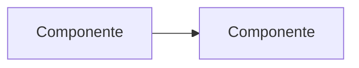

# Stack y arquitectura — <nombre del proyecto>

- **Última actualización:** YYYY-MM-DD

## Stack

| Capa | Tecnología y versión | Motivo | Revisar antes de |
| --- | --- | --- | --- |
| Frontend | | | |
| Backend | | | |
| Base de datos | | | |
| Autenticación | | | |
| Despliegue | | | |

## Arquitectura

| Componente | Responsabilidad | Expuesto a internet |
| --- | --- | --- |
| | | |

## Patrones obligatorios

| Patrón | Cómo | Por qué |
| --- | --- | --- |
| | | |

## Modelo de datos base

<Tablas principales con campos clave, unicidad e índices, o enlace a `specs/data-model.md`. Estados y transiciones.>

## Seguridad y secretos

| Secreto | Desarrollo | Producción | Responsable de rotación |
| --- | --- | --- | --- |
| | | | |

## Configuración

| Sección | Parámetro | Valor inicial | Nota |
| --- | --- | --- | --- |
| | | | |

## Entornos

| Entorno | Meta | Base de datos | Uso |
| --- | --- | --- | --- |
| Pruebas automáticas | Meta falso | Base temporal | CI |
| Desarrollo | | | |
| Producción | | | |

## Pruebas

<Unitarias, integración con base real, contrato con Meta falso, replay de webhooks, E2E, adversariales con Codex; qué corre en CI.>

## Despliegue

<Dónde corre cada componente, cómo se publica el receptor, migraciones, respaldos.>

## Observabilidad y alertas

<Logs, métricas, trazas, canal de alertas y umbrales.>

## Convenciones

- Idioma del código, de la base y de la documentación:
- Fechas y zonas horarias:
- Ramas: una por feature, `spec/YYYY-MM-DD-<feature>`; merge a `main` al cerrar.
- Commits:

## Preguntas abiertas

- 
